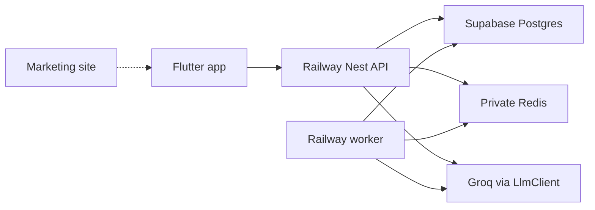

# System architecture

One Nest codebase, two processes.

- API: `node dist/main.js` via `scripts/railway-start.sh`. Serves the existing routes and `/finance/*`.
- Worker: `node dist/worker.js` via `scripts/railway-start-worker.sh`. Serves only `GET /health` and consumes BullMQ. It does not mount the public finance or ledger controllers.

Reads compute from Postgres. A fresh forecast or insight snapshot can be stored back. Redis holds the queue, a 60 second overview cache, and rate-limit counters. If `REDIS_URL` is empty, the API still answers and runs the job inline.

The phone never talks to Redis.
